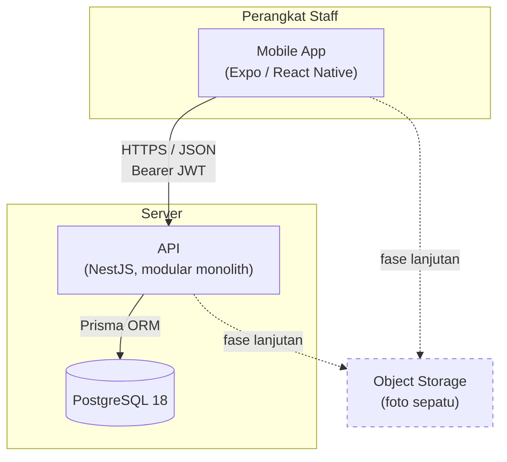
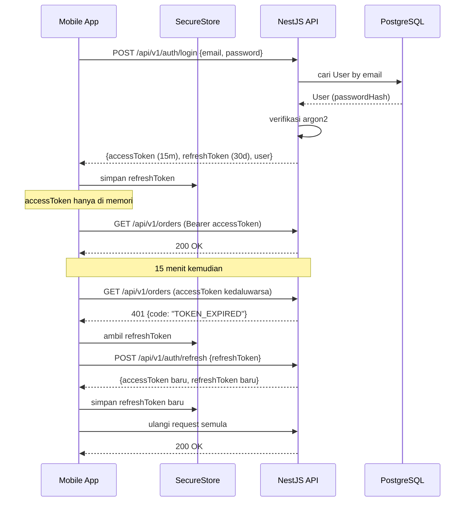
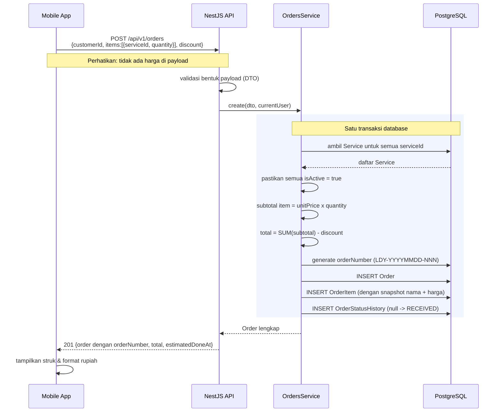
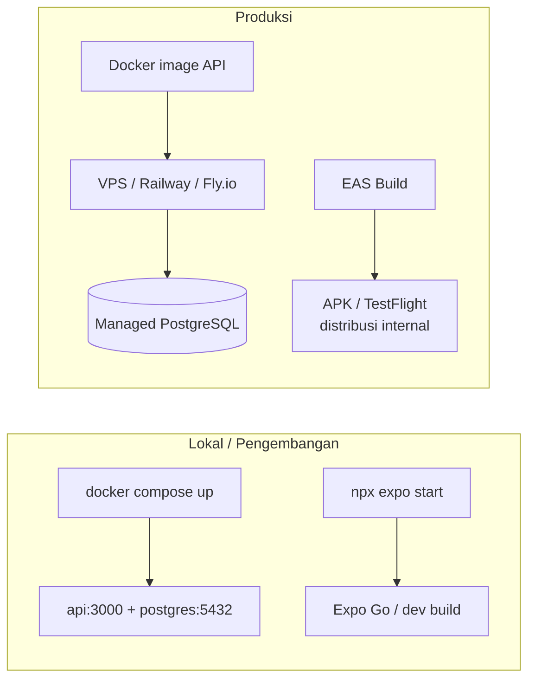

# 01 — Arsitektur Sistem

## Gambaran umum

Dua komponen yang di-deploy: **aplikasi mobile** (Expo/React Native) dan **API backend** (NestJS) dengan satu database PostgreSQL. Komunikasi lewat HTTPS/JSON. Tidak ada komponen lain di MVP.

Garis putus-putus = komponen yang **belum** dibangun di MVP, digambar supaya jalur perluasannya jelas sejak awal.

## Gaya arsitektur: modular monolith

Backend adalah **satu aplikasi yang di-deploy sebagai satu unit**, tetapi dipecah menjadi modul-modul domain yang batasnya tegas (`auth`, `customers`, `services`, `orders`, `reports`).

**Kenapa bukan microservice:**

- Tim kecil. Biaya operasional microservice (deployment terpisah, tracing terdistribusi, konsistensi lintas service) jauh melebihi manfaatnya pada skala ini.
- Domain belum stabil. Batas antar-service yang ditarik terlalu dini hampir selalu salah, dan memperbaikinya mahal.
- Transaksi pesanan menyentuh beberapa tabel sekaligus (`Order`, `OrderItem`, `OrderStatusHistory`). Dalam satu database, ini satu transaksi ACID. Dipisah jadi service, ini menjadi saga — kompleksitas yang tidak dibayar oleh kebutuhan apa pun saat ini.

**Yang tetap dijaga sejak awal:** modul berkomunikasi lewat service class, bukan dengan saling membaca tabel milik modul lain. Kalau suatu saat perlu dipecah, batasnya sudah ada.

## Batas tanggung jawab

Ini prinsip terpenting dalam dokumen ini, dan pelanggarannya adalah sumber bug paling mahal di aplikasi transaksional.

| Tanggung jawab | Di mana | Catatan |
|---|---|---|
| Harga layanan | **Server** | Client mengirim `serviceId` + `quantity`, **tidak pernah** mengirim harga. Server mengambil harga dari tabel `Service` |
| Perhitungan subtotal & total | **Server** | Client boleh menghitung untuk ditampilkan sebagai estimasi, tapi angka yang disimpan selalu hasil hitungan server |
| Nomor pesanan (`orderNumber`) | **Server** | Dijamin unik dan berurutan per hari |
| Validasi transisi status | **Server** | Client hanya menampilkan tombol untuk transisi yang valid; server tetap memvalidasi ulang |
| Otorisasi peran | **Server** | UI menyembunyikan menu `OWNER` dari `STAFF`, tapi itu kenyamanan, bukan keamanan |
| Tampilan, format rupiah, label Indonesia | **Client** | Server mengirim angka mentah dan enum, bukan string terformat |

Prinsipnya: **server tidak pernah memercayai kiriman client untuk apa pun yang berhubungan dengan uang atau status.** Yang dikirim client hanyalah niat (`serviceId`, `quantity`, `targetStatus`), bukan hasil.

## Alur kunci 1 — Login & refresh token

Kalau refresh juga gagal, aplikasi menghapus token dan mengarahkan pengguna ke layar Masuk. Detail implementasi di client ada di [05 — Mobile App](05-mobile-app.md#autentikasi-di-client).

## Alur kunci 2 — Buat pesanan

Alur ini menunjukkan bagaimana prinsip "server sumber kebenaran" bekerja secara konkret.

Tiga hal yang dipaksakan oleh alur ini:

1. **Harga diambil dari database saat itu juga**, lalu disalin ke `OrderItem` sebagai snapshot. Owner boleh menaikkan harga besok tanpa mengubah total pesanan hari ini.
2. **Layanan nonaktif ditolak.** Kalau ada `serviceId` yang `isActive = false`, seluruh request gagal dengan `SERVICE_INACTIVE` — bukan diam-diam dilewati.
3. **Semua insert dalam satu transaksi.** Tidak mungkin ada `Order` tanpa `OrderItem`, atau pesanan tanpa entri riwayat status.

## Cross-cutting concerns

| Aspek | Pendekatan |
|---|---|
| Autentikasi | JWT stateless. Access token 15 menit, refresh token 30 hari. Password di-hash dengan argon2id |
| Otorisasi | Guard global di NestJS + dekorator `@Roles(Role.OWNER)` pada handler yang dibatasi |
| Validasi input | DTO tervalidasi di lapisan controller. Request yang bentuknya salah tidak pernah sampai ke service |
| Penanganan error | Satu exception filter global → format response error seragam. Lihat [04 — API Contract](04-api-contract.md#format-error) |
| Logging | Log terstruktur (JSON) dengan `requestId` per request. Password, token, dan `passwordHash` tidak pernah masuk log |
| Migrasi database | Prisma Migrate. Migrasi versioned di git, dijalankan saat deploy — bukan `db push` di produksi |
| Konfigurasi | Semua lewat environment variable, divalidasi saat aplikasi boot. Aplikasi gagal start kalau ada yang kurang, bukan crash di tengah jalan |
| Health check | `GET /health` (proses hidup) dan `GET /health/ready` (database terjangkau) |
| Zona waktu | Database menyimpan UTC. Client menampilkan waktu lokal (WIB). Rekap harian dihitung berdasarkan batas hari Asia/Jakarta — lihat catatan di [04](04-api-contract.md#laporan) |

## Deployment

- **Backend** dibungkus dalam satu Docker image. Lokal dan staging pakai `docker-compose` (API + PostgreSQL). Produksi: PostgreSQL terkelola dengan backup otomatis — jangan jalankan database produksi di dalam container tanpa volume terkelola.
- **Mobile** dibangun dengan Expo EAS Build dan **didistribusikan internal** (APK langsung / TestFlight), bukan lewat Play Store atau App Store. Aplikasi ini untuk karyawan sendiri, jadi tidak ada proses review dan pembaruan bisa cepat.
- **Migrasi** dijalankan sebagai langkah terpisah sebelum container API baru menerima trafik.

## Yang membuat arsitektur ini bisa tumbuh

Keputusan yang sengaja diambil sekarang agar perluasan nanti tidak butuh pembongkaran:

- **Modul domain terpisah** → kalau perlu, `reports` bisa dipindah ke service sendiri tanpa menyentuh `orders`.
- **`packages/shared`** berisi enum dan tipe kontrak → menambah status pesanan baru cukup di satu tempat, dan TypeScript langsung menunjukkan semua tempat di mobile & API yang perlu menyesuaikan.
- **Snapshot harga di `OrderItem`** → laporan historis tetap benar selamanya, apa pun yang terjadi pada master layanan.
- **Skema tanpa `outletId`, tapi tidak menghalanginya** → menambah multi-outlet nanti adalah menambah kolom + backfill satu nilai, bukan mendesain ulang relasi.

---

Sebelumnya: [00 — Overview](00-overview.md) · Lanjut ke [02 — Tech Stack](02-tech-stack.md).
