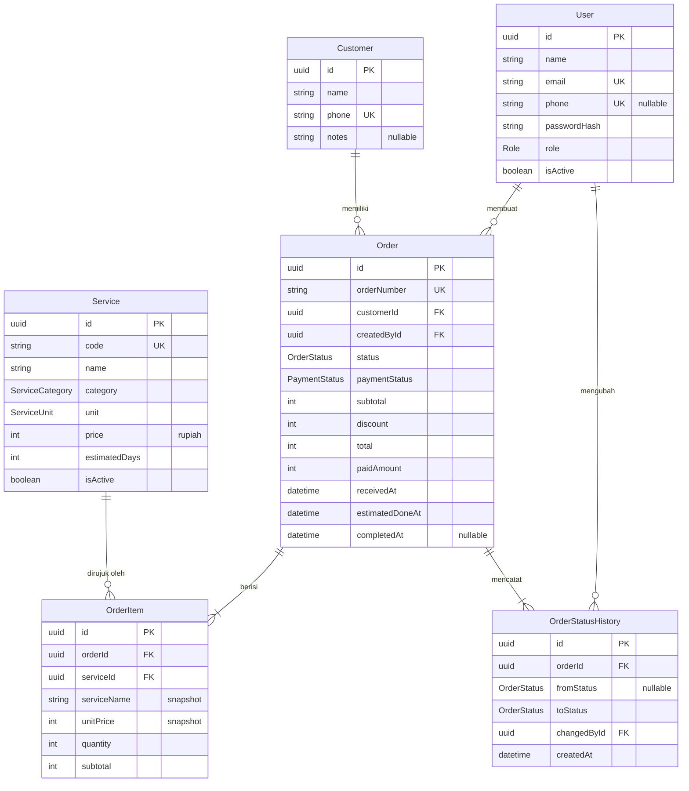
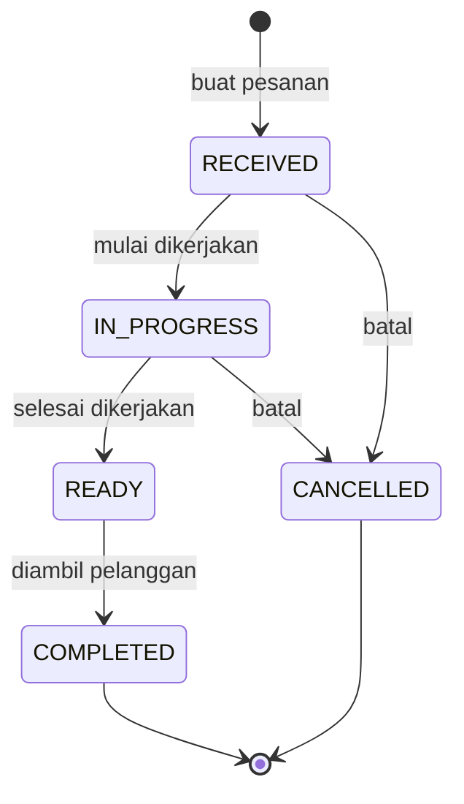

# 03 — Data Model

Dokumen ini adalah rujukan tunggal untuk struktur data. Nama enum dan field di sini dipakai **persis sama** di [04 — API Contract](04-api-contract.md) dan [05 — Mobile App](05-mobile-app.md).

## ERD



Relasi `Order ||--|{ OrderItem` adalah **satu-ke-banyak wajib**: pesanan tanpa item tidak boleh ada. Dijamin di lapisan service, bukan oleh database.

## Enum

| Enum | Nilai |
|---|---|
| `Role` | `OWNER`, `STAFF` |
| `ServiceCategory` | `SHOE_LAUNDRY`, `REPAINT`, `REGLUE`, `OTHER` |
| `ServiceUnit` | `PAIR`, `ITEM`, `KG` |
| `OrderStatus` | `RECEIVED`, `IN_PROGRESS`, `READY`, `COMPLETED`, `CANCELLED` |
| `PaymentStatus` | `UNPAID`, `PARTIAL`, `PAID` |
| `PaymentMethod` | `CASH`, `TRANSFER` |

Label Bahasa Indonesia untuk setiap nilai ada di [glosarium](00-overview.md#glosarium--istilah-ui-vs-istilah-kode).

---

## Tabel

### `User` — akun staff & pemilik

| Kolom | Tipe | Null | Default | Keterangan |
|---|---|---|---|---|
| `id` | uuid | — | `uuid()` | |
| `name` | string | — | | Nama tampil, muncul di riwayat status |
| `email` | string | — | | **Unik.** Dipakai untuk login |
| `phone` | string | ya | | Unik bila diisi |
| `passwordHash` | string | — | | argon2id. **Tidak pernah** keluar dari API |
| `role` | `Role` | — | `STAFF` | |
| `isActive` | boolean | — | `true` | Akun nonaktif tidak bisa login, riwayatnya tetap utuh |
| `createdAt` / `updatedAt` | datetime | — | otomatis | |

### `Customer` — pelanggan

| Kolom | Tipe | Null | Default | Keterangan |
|---|---|---|---|---|
| `id` | uuid | — | `uuid()` | |
| `name` | string | — | | |
| `phone` | string | — | | **Unik.** Kunci pencarian utama saat input pesanan |
| `notes` | string | ya | | Catatan bebas, mis. "sepatu putih, jangan disikat keras" |
| `createdAt` / `updatedAt` | datetime | — | otomatis | |

Sengaja minimal: staff sedang melayani pelanggan di depan meja, form panjang membuat pencatatan terlewat. Alamat baru dibutuhkan kalau ada layanan antar-jemput (fase lanjutan).

### `Service` — master tipe jasa

Ini yang dimaksud "tipe jasa" pada kebutuhan awal: cuci sepatu, repaint, reglue.

| Kolom | Tipe | Null | Default | Keterangan |
|---|---|---|---|---|
| `id` | uuid | — | `uuid()` | |
| `code` | string | — | | **Unik**, mis. `SHOE_WASH_REGULAR`. Stabil untuk seed & referensi |
| `name` | string | — | | Nama tampil Indonesia, mis. "Cuci Sepatu Reguler" |
| `category` | `ServiceCategory` | — | | Untuk pengelompokan & filter |
| `unit` | `ServiceUnit` | — | `PAIR` | Satuan jumlah |
| `price` | int | — | | Harga per satuan, **rupiah penuh** |
| `estimatedDays` | int | — | `3` | Hari kerja estimasi. Dipakai menghitung `Order.estimatedDoneAt` |
| `description` | string | ya | | Penjelasan singkat untuk staff |
| `isActive` | boolean | — | `true` | `false` = tidak muncul saat buat pesanan baru |
| `createdAt` / `updatedAt` | datetime | — | otomatis | |

### `Order` — pesanan

| Kolom | Tipe | Null | Default | Keterangan |
|---|---|---|---|---|
| `id` | uuid | — | `uuid()` | |
| `orderNumber` | string | — | | **Unik.** Format `LDY-YYYYMMDD-NNN`, dibuat server |
| `customerId` | uuid | — | | FK → `Customer` |
| `createdById` | uuid | — | | FK → `User`, staff yang mencatat |
| `status` | `OrderStatus` | — | `RECEIVED` | |
| `paymentStatus` | `PaymentStatus` | — | `UNPAID` | Turunan dari `paidAmount` vs `total` |
| `paymentMethod` | `PaymentMethod` | ya | | Diisi saat pembayaran pertama dicatat |
| `subtotal` | int | — | | Σ `OrderItem.subtotal` |
| `discount` | int | — | `0` | Rupiah, bukan persen. Hanya `OWNER` |
| `total` | int | — | | `subtotal − discount` |
| `paidAmount` | int | — | `0` | Akumulasi yang sudah dibayar |
| `notes` | string | ya | | Catatan tingkat pesanan |
| `receivedAt` | datetime | — | `now()` | Waktu sepatu diterima |
| `estimatedDoneAt` | datetime | — | | `receivedAt` + `max(estimatedDays)` dari item |
| `completedAt` | datetime | ya | | Diisi saat masuk `COMPLETED` |
| `cancelledAt` | datetime | ya | | Diisi saat masuk `CANCELLED` |
| `cancelReason` | string | ya | | Wajib saat pembatalan |
| `createdAt` / `updatedAt` | datetime | — | otomatis | |

### `OrderItem` — baris item dalam pesanan

| Kolom | Tipe | Null | Default | Keterangan |
|---|---|---|---|---|
| `id` | uuid | — | `uuid()` | |
| `orderId` | uuid | — | | FK → `Order`, `onDelete: Cascade` |
| `serviceId` | uuid | — | | FK → `Service`, `onDelete: Restrict` |
| `serviceName` | string | — | | **Snapshot** nama saat pesanan dibuat |
| `serviceUnit` | `ServiceUnit` | — | | **Snapshot** satuan |
| `unitPrice` | int | — | | **Snapshot** harga. Bukan harga master hari ini |
| `quantity` | int | — | | ≥ 1 |
| `subtotal` | int | — | | `unitPrice × quantity` |
| `notes` | string | ya | | Mis. "Nike AF1 putih, noda di ujung" |
| `createdAt` | datetime | — | otomatis | |

### `OrderStatusHistory` — jejak audit status

| Kolom | Tipe | Null | Keterangan |
|---|---|---|---|
| `id` | uuid | — | |
| `orderId` | uuid | — | FK → `Order`, `onDelete: Cascade` |
| `fromStatus` | `OrderStatus` | ya | `null` pada entri pertama (pesanan baru dibuat) |
| `toStatus` | `OrderStatus` | — | |
| `changedById` | uuid | — | FK → `User` |
| `note` | string | ya | Alasan, terutama untuk pembatalan |
| `createdAt` | datetime | — | |

### `OrderSequence` — penomoran pesanan harian

Tabel bantu, bukan bagian domain. Menjamin `orderNumber` berurutan tanpa bentrok saat dua staff menyimpan pesanan bersamaan.

| Kolom | Tipe | Keterangan |
|---|---|---|
| `date` | string PK | Format `YYYYMMDD` zona Asia/Jakarta |
| `lastNumber` | int | Nomor terakhir yang sudah dipakai hari itu |

---

## Skema Prisma

Siap disalin ke `apps/api/prisma/schema.prisma`.

```prisma
generator client {
  provider = "prisma-client-js"
}

datasource db {
  provider = "postgresql"
  url      = env("DATABASE_URL")
}

enum Role {
  OWNER
  STAFF
}

enum ServiceCategory {
  SHOE_LAUNDRY
  REPAINT
  REGLUE
  OTHER
}

enum ServiceUnit {
  PAIR
  ITEM
  KG
}

enum OrderStatus {
  RECEIVED
  IN_PROGRESS
  READY
  COMPLETED
  CANCELLED
}

enum PaymentStatus {
  UNPAID
  PARTIAL
  PAID
}

enum PaymentMethod {
  CASH
  TRANSFER
}

model User {
  id           String   @id @default(uuid()) @db.Uuid
  name         String
  email        String   @unique
  phone        String?  @unique
  passwordHash String
  role         Role     @default(STAFF)
  isActive     Boolean  @default(true)
  createdAt    DateTime @default(now())
  updatedAt    DateTime @updatedAt

  createdOrders Order[]              @relation("OrderCreatedBy")
  statusChanges OrderStatusHistory[]

  @@map("users")
}

model Customer {
  id        String   @id @default(uuid()) @db.Uuid
  name      String
  phone     String   @unique
  notes     String?
  createdAt DateTime @default(now())
  updatedAt DateTime @updatedAt

  orders Order[]

  @@index([name])
  @@map("customers")
}

model Service {
  id            String          @id @default(uuid()) @db.Uuid
  code          String          @unique
  name          String
  category      ServiceCategory
  unit          ServiceUnit     @default(PAIR)
  price         Int
  estimatedDays Int             @default(3)
  description   String?
  isActive      Boolean         @default(true)
  createdAt     DateTime        @default(now())
  updatedAt     DateTime        @updatedAt

  orderItems OrderItem[]

  @@index([isActive, category])
  @@map("services")
}

model Order {
  id              String         @id @default(uuid()) @db.Uuid
  orderNumber     String         @unique
  customerId      String         @db.Uuid
  createdById     String         @db.Uuid
  status          OrderStatus    @default(RECEIVED)
  paymentStatus   PaymentStatus  @default(UNPAID)
  paymentMethod   PaymentMethod?
  subtotal        Int
  discount        Int            @default(0)
  total           Int
  paidAmount      Int            @default(0)
  notes           String?
  receivedAt      DateTime       @default(now())
  estimatedDoneAt DateTime
  completedAt     DateTime?
  cancelledAt     DateTime?
  cancelReason    String?
  createdAt       DateTime       @default(now())
  updatedAt       DateTime       @updatedAt

  customer      Customer             @relation(fields: [customerId], references: [id], onDelete: Restrict)
  createdBy     User                 @relation("OrderCreatedBy", fields: [createdById], references: [id], onDelete: Restrict)
  items         OrderItem[]
  statusHistory OrderStatusHistory[]

  @@index([status, createdAt(sort: Desc)])
  @@index([customerId])
  @@index([createdAt(sort: Desc)])
  @@map("orders")
}

model OrderItem {
  id          String      @id @default(uuid()) @db.Uuid
  orderId     String      @db.Uuid
  serviceId   String      @db.Uuid
  serviceName String
  serviceUnit ServiceUnit
  unitPrice   Int
  quantity    Int
  subtotal    Int
  notes       String?
  createdAt   DateTime    @default(now())

  order   Order   @relation(fields: [orderId], references: [id], onDelete: Cascade)
  service Service @relation(fields: [serviceId], references: [id], onDelete: Restrict)

  @@index([orderId])
  @@index([serviceId])
  @@map("order_items")
}

model OrderStatusHistory {
  id          String       @id @default(uuid()) @db.Uuid
  orderId     String       @db.Uuid
  fromStatus  OrderStatus?
  toStatus    OrderStatus
  changedById String       @db.Uuid
  note        String?
  createdAt   DateTime     @default(now())

  order     Order @relation(fields: [orderId], references: [id], onDelete: Cascade)
  changedBy User  @relation(fields: [changedById], references: [id], onDelete: Restrict)

  @@index([orderId, createdAt])
  @@map("order_status_history")
}

model OrderSequence {
  date       String @id
  lastNumber Int    @default(0)

  @@map("order_sequences")
}
```

---

## Keputusan desain & alasannya

### Uang disimpan sebagai `Int` rupiah penuh

Tidak ada `Float`, tidak ada `Decimal`, tidak ada sen. Rupiah tidak punya pecahan yang dipakai di transaksi ritel, dan `Float` menghadirkan galat pembulatan yang muncul sebagai selisih beberapa rupiah di rekap — bug yang sangat sulit dilacak dan merusak kepercayaan pada laporan.

Batas `Int` PostgreSQL adalah 2.147.483.647, jauh di atas nilai pesanan mana pun. Untuk **penjumlahan pada laporan**, cast ke `BIGINT` di query agregat agar total bulanan tidak meluap:

```sql
SELECT SUM(total)::BIGINT FROM orders WHERE ...
```

### Snapshot nama & harga di `OrderItem`

`OrderItem` menyimpan `serviceName`, `serviceUnit`, dan `unitPrice` sebagai salinan, bukan hanya `serviceId`.

Kalau tidak begitu, menaikkan harga repaint dari 80.000 ke 90.000 akan **mengubah total semua pesanan repaint di masa lalu** — struk yang sudah dicetak jadi tidak cocok dengan data, dan laporan bulan lalu berubah setiap kali harga disesuaikan.

`serviceId` tetap disimpan supaya analitik "layanan mana yang paling laku" tetap bisa dijawab.

### `Service` dinonaktifkan, tidak dihapus

Menghapus layanan yang pernah dipesan akan memutus referensi historis. Karena itu `serviceId` memakai `onDelete: Restrict` — database menolak penghapusan — dan penonaktifan dilakukan dengan `isActive = false`.

Layanan nonaktif tidak muncul di daftar pilihan saat buat pesanan, tapi tetap tampil normal pada pesanan lama.

### Soft delete hanya untuk master data

`Service` dan `User` dinonaktifkan lewat `isActive`. `Order`, `OrderItem`, dan `OrderStatusHistory` **tidak pernah dihapus** — pesanan yang batal berstatus `CANCELLED`, dan itu adalah informasi bisnis yang bernilai, bukan sampah.

### `orderNumber` dibuat server, bukan client

Format `LDY-YYYYMMDD-NNN` (mis. `LDY-20260822-007`) dipilih karena pelanggan dan staff mengucapkannya lewat telepon dan menuliskannya di label sepatu. UUID tidak bisa dipakai untuk itu.

Penomoran memakai tabel `OrderSequence` dengan increment atomik di dalam transaksi yang sama:

```sql
INSERT INTO order_sequences (date, last_number) VALUES ($1, 1)
ON CONFLICT (date) DO UPDATE SET last_number = order_sequences.last_number + 1
RETURNING last_number;
```

Row lock pada baris tanggal berjalan menyerialkan pembuatan pesanan yang bersamaan. Pada volume outlet laundry ini tidak terasa, dan menghilangkan seluruh kelas bug nomor ganda. Menghitung `COUNT(*) + 1` **tidak aman** — dua request bersamaan akan menghasilkan nomor yang sama.

### `Customer.phone` unik

Nomor HP adalah identitas praktis pelanggan di konteks ini, dan staff mencari pelanggan dengan mengetik nomor. Keunikan mencegah data pelanggan yang sama tercecer di beberapa baris.

Nomor dinormalkan sebelum disimpan (buang spasi/tanda hubung, `08…` → `+628…`) supaya `0812-3456-7890` dan `081234567890` tidak menjadi dua pelanggan berbeda.

### `OrderStatusHistory` sebagai audit trail

Menjawab "siapa yang menandai pesanan ini selesai, dan kapan" — pertanyaan yang muncul setiap kali ada sepatu yang tercatat sudah diambil tapi masih ada di rak. Ini juga sumber data untuk timeline di layar Detail Pesanan.

### Pembayaran sebagai kolom, bukan tabel terpisah

MVP menyimpan `paidAmount`, `paymentStatus`, dan `paymentMethod` langsung di `Order`. Pola pembayaran di outlet sederhana: DP saat menyerahkan sepatu, pelunasan saat mengambil.

Kalau nanti butuh riwayat pembayaran per transaksi (misalnya setelah integrasi payment gateway), tabel `Payment` ditambahkan dan kolom-kolom ini menjadi nilai turunan. Ini perluasan, bukan pembongkaran.

---

## State machine `OrderStatus`



### Tabel transisi

| Dari | Boleh ke | Peran | Efek samping |
|---|---|---|---|
| *(baru)* | `RECEIVED` | `OWNER`, `STAFF` | Entri riwayat pertama dengan `fromStatus = null` |
| `RECEIVED` | `IN_PROGRESS` | `OWNER`, `STAFF` | — |
| `RECEIVED` | `CANCELLED` | `OWNER`, `STAFF` | Isi `cancelledAt`, `cancelReason` (wajib) |
| `IN_PROGRESS` | `READY` | `OWNER`, `STAFF` | — |
| `IN_PROGRESS` | `CANCELLED` | `OWNER` | Isi `cancelledAt`, `cancelReason` (wajib) |
| `READY` | `COMPLETED` | `OWNER`, `STAFF` | Isi `completedAt`. **Wajib `paymentStatus = PAID`** |
| `COMPLETED` | — | — | Status akhir |
| `CANCELLED` | — | — | Status akhir |

Aturan yang ditegakkan:

- **Tidak ada mundur.** Salah tandai status diperbaiki dengan koreksi bercatatan oleh `OWNER` (di luar MVP), bukan dengan transisi mundur bebas yang membuat riwayat tidak bisa dipercaya.
- **`READY → COMPLETED` menuntut lunas.** Sepatu tidak diserahkan sebelum dibayar. Kalau `paymentStatus ≠ PAID`, server menolak dengan `ORDER_NOT_FULLY_PAID`.
- **`READY` tidak bisa dibatalkan.** Pekerjaan sudah selesai; ini keputusan bisnis, bukan batasan teknis.
- **Membatalkan dari `IN_PROGRESS` hanya `OWNER`**, karena bahan dan waktu kerja sudah terpakai.

Setiap transisi yang berhasil **selalu** menulis satu baris `OrderStatusHistory`. Tidak ada jalur pengubahan status yang melewatkan ini.

---

## Aturan perhitungan

Semua dihitung di server. Client boleh menghitung untuk pratinjau, tetapi angka yang disimpan hanya berasal dari server.

```
OrderItem.subtotal = unitPrice × quantity
Order.subtotal     = Σ OrderItem.subtotal
Order.total        = Order.subtotal − Order.discount
```

`estimatedDoneAt`:

```
estimatedDoneAt = receivedAt + max(Service.estimatedDays dari seluruh item) hari
```

`paymentStatus` **selalu turunan**, tidak pernah diset langsung oleh client:

```
paidAmount = 0            → UNPAID
0 < paidAmount < total    → PARTIAL
paidAmount >= total       → PAID
```

## Invariant

Aturan yang harus benar setiap saat. Yang ditandai *(uji)* punya unit test khusus di [06 — Backend Structure](06-backend-structure.md#strategi-testing).

| # | Invariant | Ditegakkan di |
|---|---|---|
| 1 | Setiap `Order` punya minimal satu `OrderItem` | `OrdersService.create` |
| 2 | `Order.total = subtotal − discount` *(uji)* | `OrdersService`, transaksi |
| 3 | `OrderItem.subtotal = unitPrice × quantity` *(uji)* | `OrdersService`, transaksi |
| 4 | `quantity ≥ 1` | Validasi DTO + `CHECK` constraint |
| 5 | `discount ≥ 0` dan `discount ≤ subtotal` | Validasi service |
| 6 | `paidAmount ≥ 0` dan `paidAmount ≤ total` | `OrdersService.recordPayment` |
| 7 | `paymentStatus` konsisten dengan `paidAmount` vs `total` *(uji)* | Fungsi turunan tunggal |
| 8 | `orderNumber` unik | Unique index + `OrderSequence` |
| 9 | Transisi status hanya yang ada di tabel di atas *(uji)* | `assertTransitionAllowed()` |
| 10 | Setiap perubahan status menghasilkan satu `OrderStatusHistory` | Transaksi yang sama |
| 11 | `completedAt` terisi jika dan hanya jika `status = COMPLETED` | `OrdersService` |
| 12 | Pesanan baru hanya boleh memuat `Service` dengan `isActive = true` | `OrdersService.create` |
| 13 | `Order` yang sudah ada tidak pernah dihapus | Tidak ada endpoint delete |

Invariant 4 sebagai `CHECK` constraint, ditambahkan lewat migrasi manual karena Prisma belum mendukungnya secara deklaratif:

```sql
ALTER TABLE order_items ADD CONSTRAINT order_items_quantity_positive CHECK (quantity >= 1);
ALTER TABLE orders ADD CONSTRAINT orders_amounts_non_negative
  CHECK (subtotal >= 0 AND discount >= 0 AND total >= 0 AND paid_amount >= 0);
```

---

## Index

| Tabel | Index | Untuk kueri |
|---|---|---|
| `orders` | `orderNumber` (unique) | Cari pesanan lewat nomor |
| `orders` | `(status, createdAt DESC)` | Daftar Pesanan per tab status — kueri terpanas |
| `orders` | `(createdAt DESC)` | Rekap harian, daftar semua pesanan |
| `orders` | `(customerId)` | Riwayat pesanan seorang pelanggan |
| `customers` | `phone` (unique) | Pencarian saat input pesanan |
| `customers` | `(name)` | Pencarian nama sebagian |
| `services` | `code` (unique) | Seed & referensi stabil |
| `services` | `(isActive, category)` | Daftar layanan aktif per kategori |
| `order_items` | `(orderId)` | Muat item saat buka detail pesanan |
| `order_items` | `(serviceId)` | Analitik layanan terlaris |
| `order_status_history` | `(orderId, createdAt)` | Timeline di layar detail |

Pencarian nama pelanggan memakai `ILIKE '%kata%'`, yang **tidak** memanfaatkan B-tree index biasa. Pada jumlah pelanggan sebuah outlet ini tidak jadi masalah. Kalau nanti terasa lambat, tambahkan ekstensi `pg_trgm` dan GIN index — bukan sekarang.

---

## Data seed

Dijalankan lewat `prisma/seed.ts` saat menyiapkan lingkungan.

### Layanan

| `code` | `name` | `category` | `unit` | `price` | `estimatedDays` |
|---|---|---|---|---|---|
| `SHOE_WASH_REGULAR` | Cuci Sepatu Reguler | `SHOE_LAUNDRY` | `PAIR` | 35.000 | 3 |
| `SHOE_WASH_EXPRESS` | Cuci Sepatu Express | `SHOE_LAUNDRY` | `PAIR` | 60.000 | 1 |
| `SHOE_WASH_DEEP` | Deep Clean | `SHOE_LAUNDRY` | `PAIR` | 75.000 | 4 |
| `REPAINT_FULL` | Repaint Full | `REPAINT` | `PAIR` | 150.000 | 7 |
| `REPAINT_PARTIAL` | Repaint Sebagian | `REPAINT` | `PAIR` | 90.000 | 5 |
| `REGLUE_SOLE` | Reglue Sol | `REGLUE` | `PAIR` | 50.000 | 3 |

Harga di atas adalah contoh dan diubah owner lewat aplikasi.

### Akun awal

Satu akun `OWNER` dari environment variable (`SEED_OWNER_EMAIL`, `SEED_OWNER_PASSWORD`), bukan dari kredensial yang ditulis di dalam kode.

---

Sebelumnya: [02 — Tech Stack](02-tech-stack.md) · Lanjut ke [04 — API Contract](04-api-contract.md).
