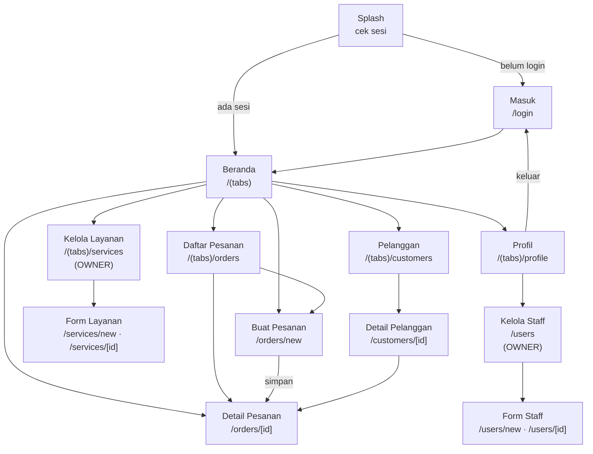
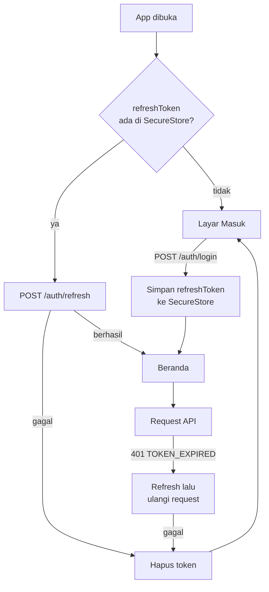

# 05 — Mobile App

Aplikasi internal untuk staff dan owner. Dipakai sambil berdiri di meja outlet, sering dengan satu tangan, sementara pelanggan menunggu. Itu yang menentukan seluruh keputusan desain di bawah.

## Prinsip

1. **Buat pesanan harus selesai di bawah satu menit.** Ini alur yang dipakai puluhan kali sehari; semua layar lain boleh mengalah demi kecepatannya.
2. **Status terbaca dalam sekali lihat.** Warna dan label chip konsisten di seluruh aplikasi.
3. **Aksi yang tidak sah tidak ditampilkan.** Tombol transisi status diambil dari `allowedTransitions` milik server, bukan dari aturan yang ditulis ulang di client.
4. **Semua teks Indonesia berasal dari satu file.** Tidak ada string berbahasa Indonesia yang ditulis langsung di dalam komponen.

## Peta layar



Nama route berbahasa Inggris; judul yang dilihat pengguna berbahasa Indonesia.

| Route | Judul UI | Peran | Endpoint yang dipakai |
|---|---|---|---|
| `/login` | Masuk | publik | `POST /auth/login` |
| `/(tabs)/index` | Beranda | semua | `GET /reports/daily-summary` (OWNER), `GET /orders?status=READY` |
| `/(tabs)/orders` | Daftar Pesanan | semua | `GET /orders` |
| `/orders/new` | Buat Pesanan | semua | `GET /services`, `GET /customers?search=`, `POST /customers`, `POST /orders` |
| `/orders/[id]` | Detail Pesanan | semua | `GET /orders/:id`, `PATCH /orders/:id/status`, `PATCH /orders/:id/payment` |
| `/(tabs)/customers` | Pelanggan | semua | `GET /customers` |
| `/customers/[id]` | Detail Pelanggan | semua | `GET /customers/:id` |
| `/(tabs)/services` | Kelola Layanan | `OWNER` | `GET /services` |
| `/services/new`, `/services/[id]` | Tambah / Ubah Layanan | `OWNER` | `POST /services`, `PATCH /services/:id` |
| `/(tabs)/profile` | Profil | semua | `GET /auth/me` |
| `/users` | Kelola Staff | `OWNER` | `GET /users` |
| `/users/new`, `/users/[id]` | Tambah / Ubah Staff | `OWNER` | `POST /users`, `PATCH /users/:id` |

**Kelola Staff** tidak diberi tab sendiri — diakses dari layar Profil. Owner memakainya sesekali saja (menambah karyawan baru, menonaktifkan yang sudah keluar), jadi tidak layak memakan ruang tab bar yang dipakai puluhan kali sehari. Daftarnya menampilkan nama, peran, dan status aktif; menonaktifkan akun memakai `PATCH /users/:id` dengan `isActive: false`, karena akun tidak pernah dihapus ([03](03-data-model.md#soft-delete-hanya-untuk-master-data)).

Tab **Kelola Layanan** disembunyikan untuk `STAFF`. Itu kenyamanan tampilan; penegakan sesungguhnya tetap di server ([04](04-api-contract.md#otorisasi-per-endpoint)).

---

## Beranda

Layar pertama setelah login. Isinya berbeda menurut peran.

```
┌─────────────────────────────────┐
│  Halo, Budi 👋                  │
│  Jumat, 22 Agustus 2026         │
├─────────────────────────────────┤
│  ┌───────────┐  ┌───────────┐   │
│  │    5      │  │    12     │   │
│  │ Diterima  │  │ Dikerjakan│   │
│  └───────────┘  └───────────┘   │
│  ┌───────────┐  ┌───────────┐   │
│  │    7      │  │ Rp 640rb  │   │
│  │Siap Diambil│ │ Omzet Hari│   │  ← kartu omzet: OWNER saja
│  └───────────┘  └───────────┘   │
├─────────────────────────────────┤
│  Siap Diambil                   │
│  ─────────────────────────────  │
│  LDY-20260820-003               │
│  Andi Wijaya · 2 item           │
│  Rp 120.000 · Belum Bayar       │
│  ─────────────────────────────  │
│  LDY-20260820-011               │
│  Rina Kartika · 1 item          │
│  Rp 50.000 · Lunas              │
├─────────────────────────────────┤
│                      ╭────────╮ │
│                      │   +    │ │  ← FAB: Buat Pesanan
│                      ╰────────╯ │
└─────────────────────────────────┘
```

Daftar **Siap Diambil** ditaruh di beranda karena itu pertanyaan paling sering di outlet: pelanggan datang, staff harus menemukan pesanannya cepat. Kartu omzet hanya muncul untuk `OWNER`.

---

## Buat Pesanan — layar terpenting

Tiga langkah dalam satu layar bergulir, bukan wizard multi-halaman. Staff bisa melihat total sambil menambah item, dan tidak kehilangan konteks saat bolak-balik.

```
┌─────────────────────────────────┐
│  ←   Buat Pesanan               │
├─────────────────────────────────┤
│  1. PELANGGAN                   │
│  ┌───────────────────────────┐  │
│  │ 🔍 Cari nama / no. HP     │  │
│  └───────────────────────────┘  │
│  ┌───────────────────────────┐  │
│  │ Andi Wijaya               │  │  ← terpilih
│  │ +6281234567890 · 4 pesanan│  │
│  │                    [Ganti]│  │
│  └───────────────────────────┘  │
│  Tidak ketemu? [+ Pelanggan Baru]│
├─────────────────────────────────┤
│  2. ITEM PESANAN                │
│  ┌───────────────────────────┐  │
│  │ Cuci Sepatu Reguler       │  │
│  │ Rp 35.000 / pasang        │  │
│  │        [−]   2   [+]   🗑 │  │
│  │ 📝 Nike AF1 putih, noda…  │  │
│  │                Rp 70.000  │  │
│  └───────────────────────────┘  │
│  ┌───────────────────────────┐  │
│  │ Reglue Sol                │  │
│  │ Rp 50.000 / pasang        │  │
│  │        [−]   1   [+]   🗑 │  │
│  │                Rp 50.000  │  │
│  └───────────────────────────┘  │
│                                 │
│      [ + Tambah Layanan ]       │
├─────────────────────────────────┤
│  3. RINGKASAN                   │
│  Subtotal            Rp 120.000 │
│  Diskon                    Rp 0 │  ← OWNER saja
│  ─────────────────────────────  │
│  Total               Rp 120.000 │
│                                 │
│  Estimasi selesai: 25 Agu 2026  │
│  ┌───────────────────────────┐  │
│  │ Catatan pesanan…          │  │
│  └───────────────────────────┘  │
├─────────────────────────────────┤
│  Total Rp 120.000               │
│  ┌───────────────────────────┐  │
│  │      SIMPAN PESANAN       │  │  ← bar melekat di bawah
│  └───────────────────────────┘  │
└─────────────────────────────────┘
```

Detail yang menentukan kecepatan:

- **Pencarian pelanggan** debounce 300 ms, mencari nama dan nomor HP sekaligus. Mengetik empat digit terakhir nomor HP sudah cukup.
- **Tambah Layanan** membuka bottom sheet berisi layanan aktif yang dikelompokkan per kategori, dengan pencarian di atas. Layanan yang sudah ada di daftar menambah `quantity`, bukan membuat baris kedua.
- **Stepper `[−] n [+]`** untuk jumlah, dengan tombol besar. Mengetik angka di keyboard lebih lambat dan lebih rawan salah.
- **Total di bar bawah** selalu terlihat tanpa menggulir. Angkanya adalah estimasi client; setelah simpan, yang ditampilkan adalah angka dari server.
- **Estimasi selesai** dihitung client sebagai pratinjau dari `estimatedDays` terbesar, lalu diganti nilai `estimatedDoneAt` dari server.
- **Field diskon** tidak dirender sama sekali untuk `STAFF`.
- Tombol Simpan **dinonaktifkan** kalau pelanggan belum dipilih atau item masih kosong, dengan alasan yang tertulis di bawahnya.

Setelah 201, aplikasi mengarahkan ke Detail Pesanan dengan snackbar `Pesanan LDY-20260822-007 berhasil dibuat` dan draft di store dibersihkan.

---

## Detail Pesanan

```
┌─────────────────────────────────┐
│  ←   LDY-20260822-007       ⋮   │
├─────────────────────────────────┤
│  ╭─────────────╮                │
│  │ Dikerjakan  │  Belum Bayar   │  ← chip status + pembayaran
│  ╰─────────────╯                │
│                                 │
│  Andi Wijaya                    │
│  +6281234567890            📞 💬│
├─────────────────────────────────┤
│  ITEM                           │
│  Cuci Sepatu Reguler            │
│  2 pasang × Rp 35.000  Rp 70.000│
│  📝 Nike AF1 putih, noda di ujung│
│                                 │
│  Reglue Sol                     │
│  1 pasang × Rp 50.000  Rp 50.000│
│  ─────────────────────────────  │
│  Subtotal            Rp 120.000 │
│  Diskon                    Rp 0 │
│  Total               Rp 120.000 │
│  Sudah dibayar             Rp 0 │
│  Sisa                Rp 120.000 │
├─────────────────────────────────┤
│  Diterima     22 Agu 2026 09:10 │
│  Estimasi     25 Agu 2026       │
├─────────────────────────────────┤
│  RIWAYAT STATUS                 │
│  ● Dikerjakan                   │
│  │ Budi · 22 Agu 13:30          │
│  ● Diterima                     │
│    Budi · 22 Agu 09:10          │
├─────────────────────────────────┤
│  ┌───────────────────────────┐  │
│  │    ✓ SIAP DIAMBIL         │  │  ← dari allowedTransitions
│  └───────────────────────────┘  │
│  ┌───────────────────────────┐  │
│  │    💰 CATAT PEMBAYARAN    │  │
│  └───────────────────────────┘  │
└─────────────────────────────────┘
```

- **Tombol aksi digenerate dari `allowedTransitions`** yang dikirim server. Client tidak menyimpan salinan tabel transisi; menambah status baru di backend tidak menuntut perubahan logika di sini.
- **Batalkan Pesanan** ada di menu `⋮`, bukan sebagai tombol utama — aksi merusak jangan mudah tersentuh. Membuka dialog yang **mewajibkan alasan** sebelum tombol konfirmasi aktif.
- Tombol **Selesai** memicu `PATCH /orders/:id/status` dengan `COMPLETED`. Kalau server menolak dengan `ORDER_NOT_FULLY_PAID`, aplikasi langsung membuka lembar Catat Pembayaran dengan sisa tagihan sudah terisi — bukan sekadar menampilkan pesan error.
- Ikon 📞 membuka dialer, 💬 membuka WhatsApp lewat deep link dengan pesan siap kirim berisi nomor pesanan dan status.

---

## Daftar Pesanan

Tab horizontal per status: **Semua · Diterima · Dikerjakan · Siap Diambil · Selesai**. Tab menerjemahkan langsung ke query `?status=`.

Setiap baris memuat nomor pesanan, nama pelanggan, jumlah item, total, chip status, dan estimasi selesai. Pencarian di atas mencocokkan nomor pesanan, nama, dan nomor HP.

Pesanan yang **melewati `estimatedDoneAt`** tetapi belum `READY` diberi penanda merah — ini yang membuat keterlambatan terlihat sebelum pelanggan menelepon.

Pull-to-refresh pada semua daftar. Infinite scroll memakai `useInfiniteQuery` dengan `page` dari `meta`.

---

## Warna & label status

Satu definisi, dipakai semua layar. Membedakan "Dikerjakan" dan "Siap Diambil" sekilas adalah kebutuhan operasional, jadi warnanya sengaja berjauhan di roda warna.

| `OrderStatus` | Label | Warna | Alasan |
|---|---|---|---|
| `RECEIVED` | Diterima | Biru | Netral, baru masuk |
| `IN_PROGRESS` | Dikerjakan | Oranye | Sedang berlangsung |
| `READY` | Siap Diambil | Hijau | Butuh aksi penyerahan — paling menonjol |
| `COMPLETED` | Selesai | Abu-abu | Selesai, tidak menuntut perhatian |
| `CANCELLED` | Dibatalkan | Merah | Kondisi tidak normal |

| `PaymentStatus` | Label | Warna |
|---|---|---|
| `UNPAID` | Belum Bayar | Merah |
| `PARTIAL` | Bayar Sebagian | Oranye |
| `PAID` | Lunas | Hijau |

Warna **tidak pernah menjadi satu-satunya pembeda** — setiap chip selalu menampilkan teks. Sekitar 8% pria mengalami gangguan penglihatan warna, dan aplikasi ini dipakai di bawah pencahayaan outlet yang tidak selalu bagus.

---

## State management

| Jenis | Alat | Isi |
|---|---|---|
| Data server | TanStack Query | pesanan, pelanggan, layanan, laporan |
| Draft pesanan | Zustand (`useOrderDraftStore`) | pelanggan terpilih, item, diskon, catatan |
| Sesi | Zustand (`useAuthStore`) | user, accessToken (memori) |
| Form | react-hook-form + Zod | Form layanan, form pelanggan |

### Konvensi query key

```ts
['orders', { status, search, page }]   // daftar
['orders', orderId]                     // detail
['services', { isActive }]
['customers', { search, page }]
['customers', customerId]
['reports', 'daily-summary', date]
```

### Invalidasi setelah mutasi

| Mutasi | Yang di-invalidate |
|---|---|
| `POST /orders` | `['orders']`, `['reports']`, `['customers']` |
| `PATCH /orders/:id/status` | `['orders', id]`, `['orders']`, `['reports']` |
| `PATCH /orders/:id/payment` | `['orders', id]`, `['orders']`, `['reports']` |
| `POST`/`PATCH /services` | `['services']` |
| `POST`/`PATCH /customers` | `['customers']`, `['customers', id]` |

### Optimistic update

Hanya untuk **perubahan status**, karena itu satu-satunya aksi yang dilakukan berulang-ulang dan jeda jaringannya paling terasa. Chip berubah seketika; kalau server menolak, state di-rollback dan snackbar merah menampilkan `message` dari server.

Pembuatan pesanan **tidak** optimistic — `orderNumber` dan `total` hanya ada setelah server merespons, dan menampilkan angka karangan pada struk adalah kesalahan yang tidak bisa dimaafkan.

`staleTime`: 5 menit untuk `services` (jarang berubah), 30 detik untuk `orders`, 0 untuk `reports`.

---

## Autentikasi di client



- **`accessToken` hanya di memori**, tidak pernah ditulis ke disk. Umurnya 15 menit; menyimpannya persisten menambah risiko tanpa manfaat.
- **`refreshToken` di `expo-secure-store`** — Keychain di iOS, Keystore di Android.
- **Interceptor refresh otomatis** pada 401 `TOKEN_EXPIRED`. Kalau beberapa request gagal bersamaan, hanya satu panggilan refresh yang jalan dan sisanya menunggu hasilnya (single-flight) — kalau tidak, rotasi refresh token akan saling membatalkan.
- Sesi 30 hari dipilih karena staff outlet tidak boleh dipaksa login ulang setiap hari di tengah pelayanan.

---

## Struktur folder

```
apps/mobile/
├── app/                          # expo-router
│   ├── _layout.tsx               # provider: Query, Paper, auth gate
│   ├── login.tsx
│   ├── (tabs)/
│   │   ├── _layout.tsx           # tab bar, sembunyikan tab OWNER
│   │   ├── index.tsx             # Beranda
│   │   ├── orders.tsx
│   │   ├── customers.tsx
│   │   ├── services.tsx
│   │   └── profile.tsx
│   ├── orders/
│   │   ├── new.tsx
│   │   └── [id].tsx
│   ├── customers/[id].tsx
│   ├── services/
│   │   ├── new.tsx
│   │   └── [id].tsx
│   └── users/                    # Kelola Staff (OWNER)
│       ├── index.tsx
│       ├── new.tsx
│       └── [id].tsx
├── src/
│   ├── features/                 # dikelompokkan per domain
│   │   ├── orders/
│   │   │   ├── components/       # OrderCard, StatusChip, ItemRow, ServicePickerSheet
│   │   │   ├── hooks/            # useOrders, useOrder, useCreateOrder, useUpdateOrderStatus
│   │   │   └── utils/            # hitung total untuk pratinjau
│   │   ├── customers/
│   │   ├── services/
│   │   └── auth/
│   ├── components/               # lintas fitur: EmptyState, ErrorState, LoadingState, Money
│   ├── lib/
│   │   ├── api/                  # client, interceptor, tipe response
│   │   ├── format.ts             # formatRupiah, formatTanggal (locale id-ID)
│   │   └── i18n/id.ts            # SEMUA teks Indonesia
│   ├── store/                    # useAuthStore, useOrderDraftStore
│   └── theme/                    # tema Paper + warna status
└── app.json
```

Pengelompokan **per fitur**, bukan per jenis file. Menambah kemampuan pada Pesanan berarti menyentuh satu folder, bukan berpindah antara `components/`, `hooks/`, dan `services/` yang masing-masing memuat potongan dari sepuluh fitur berbeda.

---

## Aturan teks Indonesia

Seluruh teks yang dilihat pengguna berasal dari `src/lib/i18n/id.ts`:

```ts
export const id = {
  common: {
    save: 'Simpan',
    cancel: 'Batal',
    search: 'Cari',
    retry: 'Coba Lagi',
  },
  order: {
    title: 'Pesanan',
    create: 'Buat Pesanan',
    number: 'Nomor Pesanan',
    subtotal: 'Subtotal',
    discount: 'Diskon',
    total: 'Total',
    paid: 'Sudah dibayar',
    remaining: 'Sisa',
    estimatedDone: 'Estimasi selesai',
    status: {
      RECEIVED: 'Diterima',
      IN_PROGRESS: 'Dikerjakan',
      READY: 'Siap Diambil',
      COMPLETED: 'Selesai',
      CANCELLED: 'Dibatalkan',
    },
    payment: {
      UNPAID: 'Belum Bayar',
      PARTIAL: 'Bayar Sebagian',
      PAID: 'Lunas',
    },
  },
  service: {
    unit: { PAIR: 'pasang', ITEM: 'item', KG: 'kg' },
    category: {
      SHOE_LAUNDRY: 'Cuci Sepatu',
      REPAINT: 'Repaint',
      REGLUE: 'Reglue',
      OTHER: 'Lainnya',
    },
  },
} as const
```

Kenapa satu file, padahal aplikasi ini hanya berbahasa Indonesia:

- Memperbaiki kalimat yang membingungkan cukup di satu tempat, bukan mencari-cari di puluhan komponen.
- Konsistensi terjaga — "Siap Diambil" tidak akan berubah menjadi "Siap diambil" di layar lain.
- Pemetaan enum → label hidup berdampingan, sehingga menambah nilai enum baru langsung terlihat sebagai label yang belum diterjemahkan.

Format angka dan tanggal memakai `Intl` dengan locale `id-ID` di `src/lib/format.ts`. Tidak ada komponen yang menyusun string rupiah sendiri.

---

## Penanganan jaringan & error

Setiap layar yang memuat data punya empat keadaan, dan keempatnya wajib diimplementasikan:

| Keadaan | Tampilan |
|---|---|
| Memuat | Skeleton, bukan spinner penuh layar — layout tidak melompat saat data datang |
| Kosong | `EmptyState` dengan kalimat spesifik + aksi. "Belum ada pesanan siap diambil", bukan "Tidak ada data" |
| Error | `ErrorState` dengan `message` dari server + tombol Coba Lagi |
| Berhasil | Konten |

- Error jaringan (tanpa response) menampilkan "Tidak ada koneksi internet. Periksa jaringan lalu coba lagi."
- TanStack Query retry 2× dengan exponential backoff untuk `GET`; **mutasi tidak di-retry otomatis** — mengulang `POST /orders` sendiri berisiko pesanan ganda.
- Error `VALIDATION_FAILED` dipetakan ke field form terkait lewat `details.fields`, bukan ditampilkan sebagai snackbar umum.

**MVP online-only.** TanStack Query menyimpan cache sehingga data yang sudah dimuat tetap terbaca sesaat saat koneksi terputus, tetapi tidak ada antrean mutasi offline. Antrean offline butuh penanganan konflik (dua staff mengubah status pesanan yang sama saat keduanya offline) dan penomoran pesanan sisi client — kompleksitas yang hanya layak dibayar kalau koneksi outlet terbukti bermasalah. Dicatat di [roadmap](07-roadmap.md) sebagai fase lanjutan.

---

Sebelumnya: [04 — API Contract](04-api-contract.md) · Lanjut ke [06 — Backend Structure](06-backend-structure.md).
