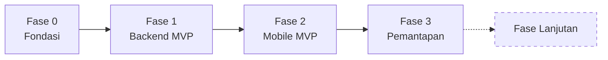

# 07 — Roadmap

Urutan implementasi. Prinsipnya: **backend selesai dan teruji sebelum mobile dimulai**, supaya pengerjaan UI tidak terhambat kontrak API yang masih berubah.

---

## Fase 0 — Fondasi

Menyiapkan tempat kerja. Tidak ada fitur yang dihasilkan, tapi setiap fase berikutnya bergantung padanya.

- Monorepo npm workspaces: `apps/api`, `apps/mobile`, `packages/shared`.
- TypeScript strict, ESLint, Prettier — konfigurasi dibagi di root.
- `docker-compose.yml` dengan PostgreSQL 18.
- Skema Prisma dari [03 — Data Model](03-data-model.md) + migrasi awal.
- `CHECK` constraint lewat migrasi manual (`quantity >= 1`, jumlah non-negatif).
- `prisma/seed.ts`: enam layanan contoh + satu akun `OWNER` dari environment variable.
- Aplikasi NestJS kosong dengan validasi env, `GET /health`, `GET /health/ready`.
- `packages/shared`: enum domain + skema Zod pertama.

**Definition of done**

- [ ] `docker compose up -d postgres` lalu `npm run -w api prisma:migrate` berhasil dari nol.
- [ ] `npm run -w api prisma:seed` mengisi 6 layanan dan 1 akun owner.
- [ ] `GET /health/ready` mengembalikan `{"status":"ok","database":"ok"}`.
- [ ] API **gagal start** ketika `DATABASE_URL` atau `JWT_ACCESS_SECRET` dihapus.
- [ ] `packages/shared` bisa diimpor dari `apps/api` dan tipe-nya terbaca.

---

## Fase 1 — Backend MVP

Seluruh API dari [04 — API Contract](04-api-contract.md), lengkap dengan pengujiannya.

**Auth**
- `POST /auth/login`, `POST /auth/refresh` dengan rotasi, `GET /auth/me`.
- Guard JWT global + `@Public()`, `RolesGuard`, `@CurrentUser()`.
- Hashing argon2id.

**Master data**
- Modul `services`: list dengan filter, create, update (`OWNER`).
- Modul `customers`: pencarian nama/HP, create dengan normalisasi nomor, detail dengan `recentOrders`.
- Modul `users`: kelola akun staff (`OWNER`).

**Orders — inti sistem**
- `POST /orders` dengan seluruh transaksi: resolusi pelanggan, ambil harga dari DB, hitung total, terbitkan nomor, simpan item + riwayat.
- `OrderNumberService` dengan increment atomik.
- `order-status.rules.ts` sebagai satu-satunya sumber aturan transisi; `allowedTransitions` ikut dikirim di response detail.
- `GET /orders` dengan filter status/tanggal/pencarian + pagination.
- `PATCH /orders/:id/status` dan `PATCH /orders/:id/payment`.

**Laporan**
- `GET /reports/daily-summary` dengan batas hari Asia/Jakarta.

**Kualitas**
- Exception filter global + katalog error.
- Logging Pino dengan redaksi field sensitif.
- Swagger di `/api/docs`.
- Sepuluh kasus uji wajib dari [06](06-backend-structure.md#strategi-testing).

**Definition of done**

- [ ] Semua endpoint di [04](04-api-contract.md) tersedia dan cocok bentuknya dengan dokumen.
- [ ] E2E hijau untuk alur penuh: login → buat pesanan → `IN_PROGRESS` → `READY` → bayar → `COMPLETED`.
- [ ] Uji concurrency: 20 `POST /orders` bersamaan menghasilkan 20 nomor unik.
- [ ] `READY → COMPLETED` tanpa lunas ditolak dengan `ORDER_NOT_FULLY_PAID`.
- [ ] Mengubah harga layanan tidak mengubah `total` pesanan yang sudah ada — dibuktikan dengan test.
- [ ] `STAFF` ditolak pada `GET /reports/daily-summary` dan pada `POST /orders` dengan `discount > 0`.
- [ ] `passwordHash` tidak muncul di response mana pun — dibuktikan dengan test.
- [ ] Swagger terbuka dan bisa dipakai mencoba seluruh alur.

---

## Fase 2 — Mobile MVP

Aplikasi dari [05 — Mobile App](05-mobile-app.md), dikerjakan berurutan dari alur paling bernilai.

**Fondasi app**
- Expo + expo-router, provider TanStack Query dan React Native Paper.
- Tema + palet warna status.
- `src/lib/i18n/id.ts` dan `src/lib/format.ts` sejak awal — bukan ditambahkan belakangan setelah string tersebar.
- Klien API dengan interceptor refresh single-flight.

**Alur berurutan**
1. Masuk + gerbang sesi + Profil (keluar).
2. **Buat Pesanan** — pencarian pelanggan, bottom sheet pilih layanan, stepper jumlah, ringkasan, simpan.
3. **Detail Pesanan** — item, timeline, tombol dari `allowedTransitions`, catat pembayaran.
4. **Daftar Pesanan** — tab status, pencarian, infinite scroll, penanda terlambat.
5. **Beranda** — kartu ringkasan + daftar Siap Diambil.
6. **Kelola Layanan** (`OWNER`) dan **Pelanggan**.
7. **Kelola Staff** (`OWNER`), diakses dari Profil.

**Definition of done**

- [ ] Staff bisa membuat pesanan dari layar kosong sampai tersimpan **di bawah satu menit**, diukur langsung dengan perangkat sungguhan.
- [ ] Pelanggan baru bisa dibuat langsung dari layar Buat Pesanan tanpa berpindah layar.
- [ ] Tombol transisi status seluruhnya berasal dari `allowedTransitions` — tidak ada tabel transisi yang ditulis ulang di client.
- [ ] Empat keadaan (memuat/kosong/error/berhasil) terimplementasi di setiap layar yang memuat data.
- [ ] Sesi bertahan setelah aplikasi ditutup dan dibuka kembali; access token kedaluwarsa ter-refresh tanpa terlihat pengguna.
- [ ] Tab Kelola Layanan tidak tampil untuk `STAFF`.
- [ ] Tidak ada string Bahasa Indonesia yang ditulis langsung di komponen — diperiksa dengan grep.

---

## Fase 3 — Pemantapan

Yang membuat aplikasi benar-benar dipakai sehari-hari, bukan sekadar berfungsi.

- **Struk via WhatsApp**: deep link `wa.me` dengan pesan berisi nomor pesanan, item, total, dan estimasi selesai. Menggantikan nota kertas tanpa integrasi apa pun.
- **Rekap harian di aplikasi** untuk `OWNER`, termasuk layanan terlaris.
- **Riwayat pesanan per pelanggan** di layar Detail Pelanggan.
- **Penanda keterlambatan** pada daftar dan beranda.
- **EAS Build** + distribusi internal, dipasang di perangkat outlet.
- Uji pemakaian sungguhan selama satu minggu di outlet, lalu perbaikan berdasarkan temuannya.

**Definition of done**

- [ ] Aplikasi terpasang di perangkat outlet lewat EAS internal distribution.
- [ ] Satu minggu penuh operasi tercatat lewat aplikasi tanpa kembali ke buku manual.
- [ ] Owner bisa menjawab "berapa omzet hari ini" dari aplikasi tanpa menghitung manual.
- [ ] Temuan dari pemakaian sungguhan tercatat dan yang kritis sudah diperbaiki.

---

## Fase lanjutan — di luar MVP

Diurutkan dari yang paling mungkin dibutuhkan lebih dulu. Tidak dikerjakan sampai ada kebutuhan nyata.

### Foto sepatu sebelum & sesudah
Object storage + upload dari kamera, ditautkan ke `OrderItem`. Menyelesaikan sengketa kondisi sepatu, dan sekaligus menjadi bahan promosi. **Bernilai paling tinggi di antara fase lanjutan.**

### Payment gateway (Midtrans / Xendit)
Menambah tabel `Payment` sebagai riwayat transaksi, dengan `Order.paidAmount` menjadi nilai turunan. Ini juga yang memperbaiki keterbatasan `revenue.collected` pada [laporan harian](04-api-contract.md#laporan).

### Notifikasi pelanggan
WhatsApp Business API atau SMS saat status berubah menjadi `READY`. Mengurangi telepon masuk "sudah selesai belum?" secara langsung.

### Multi-outlet
Tambah `outletId` pada `User`, `Order`, dan `Service`; backfill satu nilai untuk data yang ada; tambahkan penyaringan per outlet pada semua query dan laporan. Skema saat ini sengaja tidak menghalangi ini.

### Aplikasi pelanggan
Pelacakan status mandiri lewat nomor pesanan, riwayat, dan pemesanan pickup. Menggandakan lingkup auth dan keamanan — hanya layak setelah operasi internal stabil.

### Offline-first
Antrean mutasi lokal dengan penyelesaian konflik. Hanya dikerjakan kalau koneksi outlet **terbukti** bermasalah; kompleksitasnya tinggi dan risikonya nyata (pesanan ganda, status yang saling menimpa).

### Manajemen inventory
Pelacakan stok bahan (sabun, cat, lem) yang berkurang mengikuti pesanan yang dikerjakan.

### Laporan lanjutan
Tren mingguan/bulanan, pelanggan berulang, waktu penyelesaian rata-rata per jenis layanan.

---

## Yang sengaja tidak direncanakan

Ditulis supaya tidak berulang kali dibahas ulang:

- **Dashboard web.** Owner memakai aplikasi yang sama. Membangun klien kedua menggandakan permukaan pemeliharaan tanpa kemampuan baru.
- **Microservice.** Lihat alasannya di [01 — Arsitektur](01-architecture.md#gaya-arsitektur-modular-monolith).
- **Integrasi akuntansi.** Ekspor CSV dari laporan sudah cukup jauh lebih lama daripada yang diperkirakan.

---

Sebelumnya: [06 — Backend Structure](06-backend-structure.md) · Kembali ke [indeks](../README.md).
